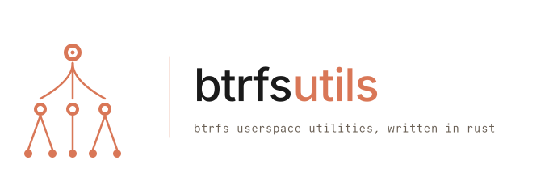

<picture>
  <source media="(prefers-color-scheme: dark)" srcset="docs/branding/banner-dark.svg">
  
</picture>

# btrfsutils

An implementation of the [btrfs-progs](https://github.com/kdave/btrfs-progs)
utilities for creating, managing and inspecting btrfs filesystems, written in
Rust.

> Warning: parts of this project are experimental. `btrfs-transaction` is a
> clean-room reimplementation of the btrfs write path and may have edge cases
> that tests don't cover. Features built on it (`btrfs-tune`, the
> `btrfs rescue` subcommands) are experimental too.

The project provides libraries for:

- talking to the btrfs kernel driver (`btrfs-uapi`)
- parsing and writing on-disk structures (`btrfs-disk`)
- parsing and writing send streams (`btrfs-stream`)
- modifying unmounted filesystems in transactions (`btrfs-transaction`)
- reading filesystems through a high-level read-only API (`btrfs-fs`), which
  drives the offline tools and the FUSE driver

These are meant to be reused by other projects that work with btrfs.

It also provides the command-line tools `btrfs` (`btrfs-cli`), `mkfs.btrfs`
(`btrfs-mkfs`), and `btrfstune` (`btrfs-tune`), which are compatible with their
btrfs-progs counterparts. They aim to be drop-in replacements but may lack some
advanced features. `btrfs-fuse` is an experimental FUSE driver that mounts a
btrfs image or block device read-only, without kernel btrfs support.

## Goals

- **Drop-in compatibility.** Every command's output matches btrfs-progs
  exactly. Scripts, monitoring tools, and muscle memory work unchanged.
- **Opt-in extras.** Pass `--format modern` or set
  `BTRFS_OUTPUT_FORMAT=modern` for cleaner output, progress bars, and adaptive
  column widths.
- **Reusable libraries.** The low-level crates (`btrfs-uapi`, `btrfs-disk`,
  `btrfs-stream`, `btrfs-transaction`) are written from scratch, designed to be
  ergonomic, and licensed MIT or Apache-2.0.

## Status

The project is under active development. Most commands are fully implemented
and match the output of btrfs-progs.

`btrfs check` runs a 7-phase read-only verification. All `btrfs rescue`
subcommands are implemented, including `chunk-recover`, which rebuilds a
damaged chunk tree from surviving on-disk leaves. With `--apply` it writes the
rebuilt tree through `btrfs-transaction`.

`btrfs-transaction` provides copy-on-write access to unmounted filesystems.
It handles delayed refs, free space tree updates, chunk tree COW, and
conversion to the v2 free space tree and the block group tree. It backs
offline `btrfs filesystem resize`, the rescue commands, and
`btrfs-tune --convert-to-free-space-tree` and
`--convert-to-block-group-tree`.

## Installation

There are three executables:

- `btrfs` configures and monitors btrfs filesystems.
- `btrfs-mkfs` formats devices, or builds filesystem images from a directory.
- `btrfs-tune` changes feature flags, UUIDs, and seeding on unmounted
  filesystems.

Install them as separate binaries:

```sh
cargo install btrfs-cli btrfs-mkfs btrfs-tune
```

Or install only `btrfs` with the other tools embedded:

```sh
cargo install btrfs-cli --features mkfs,tune,multicall
```

The `mkfs` and `tune` features add the `btrfs mkfs` and `btrfs tune`
subcommands. The `multicall` feature makes the binary dispatch on its program
name, busybox-style: symlink or hardlink it to `mkfs.btrfs`, `btrfs-mkfs`,
`btrfstune`, or `btrfs-tune` and it runs that tool.

Combined with a static `x86_64-unknown-linux-musl` build, this gives a single
portable binary.

### Pre-built packages

`just package` builds release artifacts for the `x86_64`, `aarch64`, and
`riscv64gc` Linux musl targets:

- `btrfsutils_<ver>_<arch>.deb` and `btrfsutils-<ver>-1.<arch>.rpm`: the
  multicall `btrfs` binary, symlinks for `mkfs.btrfs`, `btrfstune`,
  `btrfs-mkfs`, and `btrfs-tune`, man pages, and shell completions.
- `btrfsutils-<arch>.tar.zst`: a relocatable tarball with the binary,
  symlinks, and docs.
- `btrfs-<arch>.zst`: the bare multicall binary, zstd-compressed.

This needs `cargo-zigbuild`, `cargo-deb`, `cargo-generate-rpm`, and `zstd` on
`PATH`. Output goes to `target/dist/`.

## Building

Requires a Rust toolchain (edition 2024) and Linux kernel headers.

```
cargo build --release
```

The resulting binaries are `target/release/btrfs`, `target/release/btrfs-mkfs`,
and `target/release/btrfs-tune`.

To build with Nix:

```
nix build
```

The output includes the binaries and compressed man pages.

## Usage

```
btrfs <command> [<args>]
```

Commands mirror the original `btrfs` tool:

```
btrfs filesystem show
btrfs subvolume list /mnt/data
btrfs device stats /mnt/data
btrfs scrub start /mnt/data
```

Most commands that talk to the kernel require root privileges or `CAP_SYS_ADMIN`.

## Folder structure

| Folder | Description |
|-------|-------------|
| `uapi` | Safe Rust wrappers around btrfs kernel ioctls, sysfs, and procfs. Linux-only. |
| `disk` | Platform-independent parsing and serialization of btrfs on-disk structures. |
| `stream` | Send stream parser and encoder. Optional Linux-only receive support. |
| `transaction` | Transactional read-write access to unmounted filesystems: COW tree edits, delayed refs, free space tree and chunk tree updates, and full-tree conversions. Platform-independent. |
| `cli` | The `btrfs` command-line tool. |
| `mkfs` | Filesystem creation tool (`mkfs.btrfs`). Builds B-tree nodes and writes them directly to block devices or image files. |
| `tune` | Offline superblock tuning tool (`btrfstune`). Changes feature flags, seeding, and filesystem UUIDs on unmounted devices. |
| `fuse` *(experimental)* | Read-only userspace FUSE driver (`btrfs-fuse`) for images and block devices. Needs no kernel btrfs support. |
| `util/gen` | Generates man pages and shell completions (bash, zsh, fish, elvish) with `clap_mangen` and `clap_complete`. |
| `docs` | Documentation, rendered with mdBook. |

## Testing

Run the unit tests, which need no privileges:

```
cargo test
```

The integration tests create and mount file-backed filesystems, so they need
root. Rather than running `sudo cargo test`, use the wrapper, which builds the
tests as your user and runs only the integration tests with `sudo`. This runs
the full suite:

```
just test
```

To generate a coverage report (needs `cargo-llvm-cov`):

```
just coverage
```

The [testing guide](https://rustutils.gitlab.io/btrfsutils/dev/testing.html)
covers the test layout, fixtures, the `cargo insta` workflow, and the
privileged harness.

## License

The library crates (`btrfs-uapi`, `btrfs-disk`, `btrfs-stream`,
`btrfs-transaction`) are original work. They are licensed under either the
[Apache License, Version 2.0](uapi/LICENSE-APACHE) or the
[MIT license](uapi/LICENSE-MIT), at your option, so other Rust crates can use
them freely.

The application crates (`btrfs-cli`, `btrfs-mkfs`, `btrfs-tune`) follow the
[btrfs-progs](https://github.com/kdave/btrfs-progs) C implementation and are
licensed under the [GNU General Public License v2.0](LICENSE.md).

The kernel UAPI headers included for bindgen are licensed separately under
GPL-2.0 with the Linux syscall note exception, which permits their use by
non-GPL userspace programs.
