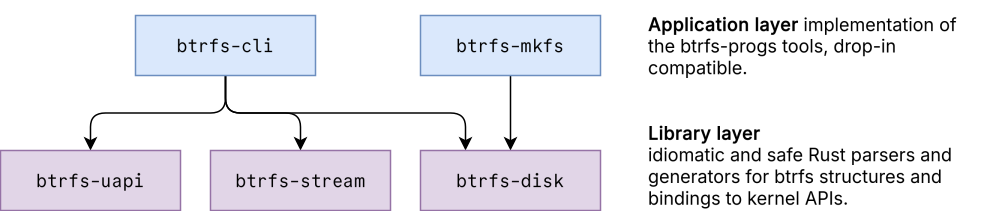

# Architecture

## Crate structure

The crates are strictly layered. Lower crates know nothing about the layers
above them.

 

`btrfs-uapi` wraps kernel ioctls, sysfs reads, and procfs reads in safe Rust
APIs. It is Linux-only and is the only crate that talks to the kernel.

`btrfs-disk` parses on-disk structures (superblocks, B-tree nodes, item
payloads) from raw byte buffers. It is platform-independent and does not
depend on `btrfs-uapi`, so it can inspect filesystem images on any OS.

`btrfs-stream` parses the btrfs send stream format and encodes
`StreamCommand` values back into it. The parser and encoder are
platform-independent. The optional `receive` feature is Linux-only and applies
a parsed stream to a mounted filesystem through `btrfs-uapi`.

`btrfs-transaction` provides copy-on-write access to unmounted filesystems on
top of `btrfs-disk`. It handles delayed refs, free space tree updates, chunk
tree COW, and conversion to the v2 free space tree and the block group tree.
It is platform-independent. It backs offline `btrfs filesystem resize`, the
rescue commands, the `btrfs-tune` conversions, and most of `btrfs-mkfs`.

`btrfs-fs` is a high-level read-only filesystem API on top of `btrfs-disk`.
Its `Filesystem<R>` handle offers POSIX-style operations (`lookup`, `readdir`,
`readdirplus`, `read`, `xattr_get`, `seek_hole_data`, ...) and btrfs-specific
ones (`tree_search`, `ino_paths`, `list_subvolumes`, `send`). Inodes are
modelled as `(SubvolId, ino)`, so traversal across subvolumes works. All
operations are `async fn` and run sync I/O through `spawn_blocking`. The crate
does not depend on FUSE. It drives the `btrfs-fuse` mount, the
`btrfs send --offline` path, and any other embedder.

`btrfs-mkfs` implements `mkfs.btrfs`. It builds the bootstrap trees (root,
extent, chunk, and dev) as raw byte buffers and writes them to a block device
or image file with `pwrite`. It then reopens the image through
`btrfs-transaction` to create the remaining trees and, with `--rootdir`, to
populate the filesystem.

`btrfs-tune` implements `btrfstune`. It changes superblock parameters (feature
flags, seeding, filesystem UUIDs) on unmounted devices. A lightweight UUID change
only rewrites the superblock. A full fsid rewrite visits every tree block on
disk through `btrfs-disk`. The `--convert-to-free-space-tree` and
`--convert-to-block-group-tree` conversions run through `btrfs-transaction`.

`btrfs-fuse` is a thin `fuser::Filesystem` adapter on top of `btrfs-fs`. All
filesystem semantics live in `btrfs-fs`. This crate adds the FUSE protocol
mapping (inode-number translation, `Stat` → `FileAttr`, `Reply*` glue) and a
tokio multi-thread runtime so concurrent FUSE callbacks don't serialise. It
ships as the standalone `btrfs-fuse` binary and as the `btrfs fuse`
subcommand behind the opt-in `fuse` cargo feature of `btrfs-cli`.

`btrfs-cli` implements the `btrfs` tool. It parses arguments with clap, calls
into `btrfs-uapi`, `btrfs-disk`, `btrfs-stream`, `btrfs-fs`, and
`btrfs-transaction`, and formats all output. It can also embed `btrfs-mkfs`,
`btrfs-tune`, and `btrfs-fuse` as subcommands for single-file deployment.

## The two-layer model

Every feature that talks to the kernel is split across two layers:

- The `uapi/` layer provides a safe Rust function. It takes typed arguments,
  calls the ioctl, and returns a typed result. Its public API has no `unsafe`
  and knows nothing about the CLI.
- The `cli/` layer provides a clap subcommand. It calls into `uapi/` and
  formats the result. It makes no ioctl calls and uses no raw kernel types.

This applies to all kernel interfaces. btrfs ioctls, standard VFS ioctls like
`FS_IOC_FIEMAP`, and block device ioctls like `BLKGETSIZE64` all live in
`uapi/`, never in `cli/`.

The same principle applies to `disk/`. It parses raw bytes into typed structs,
and `cli/` handles all display formatting. The `disk/` crate never calls
`println!`.
